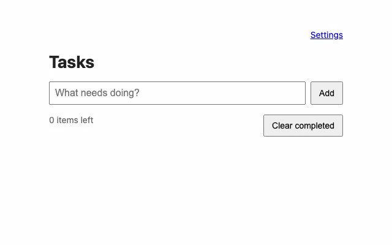
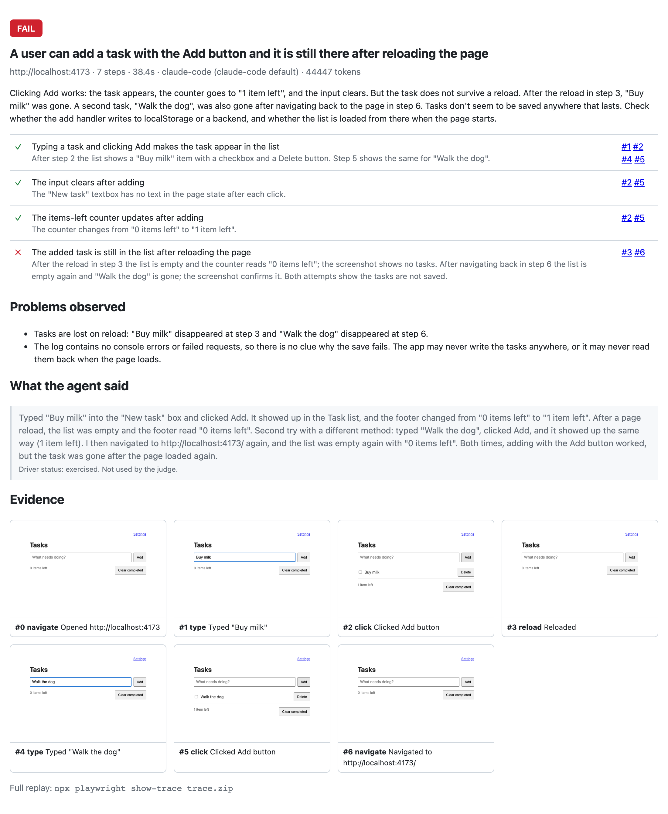

# Witness

**Agents don't get to say "it works" without a witness.**

Witness is a verification harness for coding agents. You give it a goal in plain English and a running web app. It drives the real app in a browser, records everything, and has a separate judge decide from that evidence alone whether the goal is actually met.



```bash
witness verify "A user can add a task with the Add button and it is still there after reloading the page"
```

```
FAIL  Clicking Add does add "Buy milk" and clears the input (step 2), but the task is gone after
      reloading (step 3 snapshot and screenshot show an empty list and "0 items left"). The same thing
      happens with Enter and "Walk dog" (steps 4–5), so tasks are not being saved.
  ✓ Typing a task and clicking the Add button adds it to the task list  [#1, #2]
  ✓ The input clears after adding  [#2]
  ✓ The items-left counter updates after adding  [#2]
  ✗ The added task is still in the list after reloading the page  [#3]
  ✗ The task persists whether it was added with Add or with Enter (consistency check)  [#4, #5]

evidence: .witness/runs/2026-11-22T21-14-10-236Z/report.html
```



## For coding agents: MCP server and skill

Witness is built to sit at the end of an agent's own task: the agent changes the code, Witness proves it. It runs as an MCP server:

```bash
claude mcp add witness -e WITNESS_URL=http://localhost:3000 -- node /path/to/witness/bin/witness.js mcp
```

| Tool | What it does |
|---|---|
| `witness_verify` | Drive the app to exercise a goal and return the judge's verdict, criteria, problems and evidence path. A pass is saved as a replay. |
| `witness_replay` | Re-check every verified goal with no LLM. `heal: true` re-verifies divergences. |
| `witness_map` | Build the Feature Map, or `check: true` to detect drift with no LLM. |
| `witness_auth` | Log in once, with `{{secret:NAME}}` credentials. Later runs start signed in. |
| `witness_replays` | List the verified goals. |

[`skills/witness/SKILL.md`](skills/witness/SKILL.md) is the playbook that goes with it. Copy it to `.claude/skills/witness/` in your project. It tells the agent:
- when to verify (after any user-facing change, before saying "done")
- how to write a goal (a user-visible outcome, not "test the add feature")
- that `fail` and `inconclusive` mean *not done*
- to run `witness_replay` before finishing

**Test drive.** I gave a fresh headless Claude Code session a copy of the demo app with a real typo bug: tasks saved under `witness-demo-todo` but loaded from `witness-demo-todos`. The prompt was only *"Users report that their tasks disappear after they reload the page… Fix it."* It never mentioned Witness. The session:

```
→ Glob, Read index.html, Read server.js
  "The save key is `witness-demo-todo` but load reads `witness-demo-todos`."
→ Edit index.html
→ Skill witness                         ← picked the skill up on its own
→ witness_verify "A user can add a task with the Add button, and after reloading the page the task is still in the list"
→ witness_replay
  "Witness: PASS. In a real browser, it added a task with the Add button, reloaded the page, and the task was
   still in the list. All 6 checks passed, with no console errors. Evidence: .witness/runs/…/report.html"
```

It also raised something on its own: tasks users saved under the old key won't come back by themselves, and it offered to migrate them.

## Tested on real open-source apps

Two agent sessions used Witness to fix four real open issues:
- [Actual Budget](https://github.com/actualbudget/actual), which runs entirely in the browser: [#3051](https://github.com/actualbudget/actual/issues/3051) and [#8972](https://github.com/actualbudget/actual/issues/8972)
- [Uptime Kuma](https://github.com/louislam/uptime-kuma), a full-stack app with Node, Socket.IO, SQLite and a login: [#7805](https://github.com/louislam/uptime-kuma/issues/7805) and [#7897](https://github.com/louislam/uptime-kuma/issues/7897)

Witness reproduced each bug as a FAIL before the fix. After the fix it gave PASS on three of them. On the fourth, #3051, it gave a false FAIL, because the Driver had no way to click empty space.

Those runs also exposed what breaks on real apps. All of these are fixed now. Secrets, saved logins, live-data replays and build tracking were re-checked on the live Uptime Kuma instance; the new browser tools are covered by the automated tests, and #3051 hasn't been re-run with `click_at` yet:

| Found on a real app | Fix |
|---|---|
| The test password ended up in 29 report and replay files, and in file names | **Secrets**: goals use `{{secret:NAME}}`; values are typed for the agent and redacted everywhere. Re-test: 0 files. |
| Every run spent its first steps logging in, and the map crawled only the login page (2 pages) | **`witness auth`** saves a login once. Re-test: the map found 20 pages and 10 features. |
| Live counters (heartbeats, "31m") made every replay diverge, even right after a heal | **Live-data learning**: number-only changes are flagged, and `--heal` learns them as volatile. Re-test: 3/3 stable replays. |
| Element names with live numbers in them ("Heartbeat history: 18 checks") | Replays match those names with the numbers as wildcards |
| The agent couldn't click empty space, which caused #3051's false FAIL | **`click_at`** tool |
| The agent couldn't pick from `<select>` dropdowns | **`select_option`** tool |
| Goals with the same opening overwrote each other's replays, and heal left duplicates | Replay names get a short hash, and heal keeps the name |
| A run that hit the usage limit died with no evidence | Aborted runs are **INCONCLUSIVE**, keep their evidence, and write `progress.log` as they go |
| The branch said `master`, but the server still served the previous branch's build, so a manual test contradicted Witness | **What was tested**: every report records the commit and a fingerprint of the JavaScript the browser loaded, and warns when the served build is older than the code. See below. |

## Secrets and signing in

```bash
echo 'APP_USER=test-admin' >> .witness/secrets.env      # or WITNESS_SECRET_APP_USER=...
echo 'APP_PASS=...'        >> .witness/secrets.env
witness auth "Log in as {{secret:APP_USER}} with password {{secret:APP_PASS}}"
witness map                # now crawls the signed-in app
witness verify "Signed in, a user can create an MQTT monitor and it is still listed after a reload"
```

- **Goals refer to credentials by placeholder.** The Driver types `{{secret:APP_PASS}}`, Witness swaps in the value at the moment of typing, and every recorded artifact is redacted back to the placeholder: steps, snapshots, reports, replays, logs and file names.
- **Screenshots** black out any field holding a secret.
- **The Playwright trace is skipped** while secrets are configured, since it stores raw DOM values.
- **Exported tests** read secrets from `WITNESS_SECRET_*` at run time.
- **`witness auth`** keeps the login only if the Judge confirms you're signed in. The cookies go to `.witness/auth.json`, which is gitignored. Use `--no-auth` to ignore it.
- **`witness auth --manual`** is for single sign-on, MFA, or anything you wouldn't give an agent a password for. It opens a visible browser, and you sign in yourself; pop-ups and extra tabs are fine. Press Enter in the terminal when the app shows you signed in. Witness then:
  - checks the saved session by opening the app in a fresh browser. If that lands on another site, it saves nothing. If it shows a password field, or looks exactly as it does signed out, it asks you before saving;
  - saves sessionStorage too, which Playwright's storage state leaves out, though some sign-in libraries keep their tokens there;
  - lets later runs load pages from the sign-in sites you went through, for silent token refresh. Secrets are never typed on them, only on the app's own origin and any you list in `WITNESS_ALLOWED_ORIGINS`.
- **Expired logins are flagged.** If the saved cookies have expired, the run warns you to sign in again.
- **The browser stays on the app.** Pages load only from the app's origin. Navigating elsewhere, following an off-site link or opening a local `file://` path is blocked and recorded as a failed step, so text in the app under test can't steer the Driver somewhere else. Secrets are typed only into fields on allowed origins. If login goes through another site, such as an identity provider, list it: `WITNESS_ALLOWED_ORIGINS=https://login.example.com`.

## Running on a company app

These options came from a first run on an internal app on a locked-down Windows laptop, behind single sign-on:

| Option | What it does |
|---|---|
| `witness auth --manual` | You sign in yourself in a visible browser (see above). |
| `--channel msedge` / `chrome` / `brave` (or `WITNESS_BROWSER_CHANNEL`) | Uses an installed browser instead of Playwright's Chromium, which policy may block. Brave is looked up in its usual install location. For any other Chromium-based browser, pass the path to its executable. Applies to verify, replay, map and auth. |
| `WITNESS_READY_SELECTOR="nav .menu"` | After each page load, waits for this element, then for the network to go quiet (always done, for up to 5 seconds), before taking evidence. For app shells that show a spinner or skeleton first. `WITNESS_READY_TIMEOUT_MS` sets how long to wait for the element (default 15000). If it never appears, the run continues; the first step notes it. |
| `witness.ignore-errors.txt` (or `WITNESS_IGNORE_ERRORS=<regex>`) | Lists known-noise errors, one per line, as a substring or `/regex/flags`: a telemetry script the proxy blocks, or a missing favicon. Matching errors are left out of the evidence, so they don't fail goals or break replays. They're still counted, in the report under "Ignored as known noise" and in replay results. |
| Backend check | Before opening a browser, Witness checks that the backend can run: Claude Code is installed and signed in, or the API key works. If not, it fails in about a second and tells you what to do. |

## What was tested

A verdict is only as useful as knowing which code it was about. Every report has a **What was tested** section:

```
tested:   code 33cd7c7 (fix/mqtt-hostname) + 1 uncommitted · build 441701d9312e (1 script) · service worker active
  ⚠ The app's JavaScript may be an old build: the newest script the server sent was last modified 12:40,
    before the latest code change (HEAD moved to 33cd7c7, 12:52). Rebuild or restart the app, then run again.
```

- **code**: the commit, branch and uncommitted files in the repo Witness runs from.
- **build**: a hash of the scripts the first page loaded. The same build gives the same fingerprint, so you can tell two runs tested identical JavaScript.
- **Stale-build warning**: for an app on this machine, if the server's `Last-Modified` on its scripts is older than the latest code change (a checkout, a commit or an uncommitted frontend edit), the served build probably isn't the code you think you're testing.
- **Replays** remember the build they were recorded on. When one diverges on the same build, the cause is data, the backend or the environment, not the frontend code.

Witness starts every run in a fresh browser. A tab you already had open, or a service worker, can keep running an older build, so hard-reload before checking by hand.

## Replay: verify once with an agent, re-check for free

A passing `verify` is saved as a **replay**: the exact steps, plus the accessibility tree expected after each one. Replays run with no LLM, in about a second.

```bash
witness replay            # all saved replays, deterministic, no model calls
witness replay --heal     # on divergence, ask the agent again
witness export            # write them as plain Playwright tests
```

```
✗ a-user-can-add-a-task-with-the-add-button-and-it-is-still  diverged at step 0 (open): page differs from the recorded run
    + - heading "My tasks" [level=1]
    - - heading "Tasks" [level=1]
      - textbox "New task":
      …
  healing: re-verifying "A user can add a task with the Add button…" with the agent…
  HEALED  The app changed, but the goal still holds. Replay re-recorded.
```

**Live data.** If only the numbers on some lines changed, such as counters, timestamps or uptime %, the replay says so. `--heal` re-verifies the goal with the agent. If it still holds, it learns those lines as `volatile`: their numbers are masked from then on. Masking is per line, so a wrong count elsewhere is still caught. You can also add regexes to a replay's `ignore` list by hand.

A divergence doesn't automatically mean a bug. With `--heal`, Witness sends the goal back to the agent and the judge:
- **HEALED**: the UI changed but the goal still holds, so the replay is re-recorded.
- **REGRESSION**: the goal is broken, with a full evidence report.

The model is used only when something actually changed.

Replays find elements by role and accessible name (`getByRole("button", { name: "Add" })`), not CSS selectors, so they survive markup refactors. `witness export` turns each one into a standalone `@playwright/test` spec using `toMatchAriaSnapshot`, so you can run it in any CI without Witness.

## Feature Map: what the agent reads first

```bash
witness map           # crawl the app and write witness.map.yaml
witness map --check   # re-crawl and report drift, no LLM (exit 1 on drift)
```

The Mapper has two parts:
- A **deterministic crawl**: every same-origin page, its title, accessibility tree and controls.
- **One model call**: turns the crawl, plus the newest lesson per goal from past `verify` runs, into features. Each feature gets how to reach it, the controls it uses, what should happen, and *traps*, such as a setting on another page that changes behavior here.

Pages and controls in the map come from the crawl, not the model, so `--check` can diff them and name the features whose controls disappeared:

```
✗ witness.map.yaml has drifted from the app:
  + /: button "Add task"
  - /: button "Add"
  ! feature "Add a task" relies on missing button "Add"
```

`verify` gives the map to the Driver automatically when `witness.map.yaml` exists (`--no-map` to skip). The Judge never sees the map, so the verdict still rests on evidence only. The map is plain YAML, meant to be edited and committed. See [witness.map.yaml](witness.map.yaml) for the demo app's map.

Lessons from runs are written as things to check, with a date ("reload to confirm tasks persist; a run on 2026-11-22 found they did not"), never as facts. A bug that has since been fixed shouldn't become permanent lore.

### Scenarios: the code as a hypothesis

A crawl only follows links, so it misses routes nothing links to, forms behind buttons, and flows that take several steps. Run from the app's repo, `witness map` also reads the source:

```bash
witness scan                  # what the code says the app has: local, instant, no LLM
witness map                   # crawl + code, when the code's routes match the app
witness map --code ../my-app  # the source is somewhere else
witness map --no-code         # crawl only
```

- **The scan** finds React Router and Vue Router routes, form controls with their validation rules, Express endpoints, socket.io events, status and role values, and end-to-end test titles.
- **The crawl then opens routes nothing links to.** A route counts as seen only if it opens as its own page, not as an error, a redirect or a copy of another page. Routes whose names suggest they sign out or change data (`/logout`, `/delete-account`) are never opened.
- **The model writes scenarios** from both: what each flow needs first, its steps, and what the code suggests should happen.
- **Labels come from matching, not from the model.** `from code` means only the source suggests it. `seen in app` means the crawl saw the scenario's pages and controls, *not* that the flow works. Citations that don't exist in the scan are removed, and a scenario with nothing behind it is dropped.
- **The Judge never uses the map.** On Uptime Kuma, the code says an API key's Name is required. A run that opened the form but never tried to submit it empty came back *inconclusive*, because nothing on screen showed it.
- **`--check`** also reports routes added to or removed from the code.

The scan runs locally, but `witness map` sends the model names from it: route paths, control labels, endpoints, status values and test titles, not the source itself. They're also saved in `witness.map.yaml`.

What it doesn't do yet: Next.js and other file-based routes, Angular, GraphQL, server-rendered templates, forms more than one import away from a route, or status *transitions* (it lists the values, not which can follow which). It doesn't yet mark scenarios as proven by a run.

## Eval: does it actually catch bugs?

```bash
npm run eval                                 # all cases
npm run eval -- --only add-persist,delete    # some goals
npm run eval -- --trials 3                   # repeat each case to measure variance
```

There are 5 goals (in `eval/cases.ts`), and each runs against 3 kinds of app:
- the clean demo app, where it should pass
- each bug that breaks the goal, where it should fail
- a harmless UI change, where it should still pass

That is 14 cases. The eval reports:
- **bug catch rate**
- **false alarm rate**
- accuracy, time and tokens
- **replay catch rate**: each passing clean recording replayed against every variant with no LLM

Results go to `.witness/evals/<id>/summary.md` and `results.json`, with a link to every run's evidence report.

### Latest results ([3 trials, 2026-11-23](docs/eval/2026-11-23-trials3.md) · [previous](docs/eval/2026-11-22-trials3.md))

| Metric | Result |
|---|---|
| Bug catch rate | **24/24 (100%)** |
| False alarm rate | **0/18 (0%)**, including a harmless UI change |
| Same verdict on all 3 trials | **14/14 cases** |
| No-LLM replay catch rate | **8/8 (100%)**, mean 1.4s per replay |
| Agent run | mean 38s, 15.4 browser actions |

These came from the `claude-code` backend (Claude Opus 5.5 on a Claude subscription), 3 trials per case, 42 agent runs, on the current Driver and Judge.

**The eval caught a flaky rule in the Judge.** The first re-run after the real-app fixes scored 21/24. The Judge saw an uncaught error on every Add click and said it should be fixed, but judged the goal a pass anyway, 3 times out of 3. The previous eval had failed the same runs. The Judge's instructions never said whether errors fail a goal, so the verdict depended on interpretation. Now they do, and the full re-run is back to 24/24 (one goal was re-run separately after hitting the usage limit). [Details](docs/eval/2026-11-23-trials3.md#what-this-re-run-found).

Every FAIL verdict named the actual bug, citing specific steps. Examples:
- *"clicking Delete 'Bravo' removed Charlie and left Bravo"*
- *"the counter is always one too high"*
- *"clicking Add threw an uncaught error … so the flow did not run cleanly"*, where the UI itself looked fine

**Caveats:**
- The demo bugs are deliberately clear-cut, and the same author wrote both the bugs and the goals.
- The next step is seeded bugs in a real app, plus subtler bugs such as race conditions and visual-only regressions.

## Why

Coding agents report success when the code compiles or the tests they wrote pass. Witness makes "done" mean *evidence*: screenshots, console errors, failed requests and a replayable trace, judged by a model that never saw the agent's reasoning.

**The codebase is the hypothesis. Observed behavior is the evidence.** Code, and the agent's account of it, say what *should* happen. Only what the running app does can pass a goal. The Feature Map can guide the agent, but it is never evidence.

## How it works

| Piece | What it does |
|---|---|
| **Driver** (`src/driver.ts`) | Claude agent loop with browser tools (snapshot, click, type, select_option, click_at, press, navigate, reload, screenshot). It exercises the goal like a user would and reports what it did, not whether it worked. |
| **Evidence** (`src/browser.ts`) | Every action gets a screenshot, the accessibility tree afterwards, new console errors, failed requests and dialogs. Dialogs are accepted the way a user would, and their text is kept. The whole run is captured as a Playwright trace, unless secrets are configured. |
| **Judge** (`src/judge.ts`) | A separate model call that sees only the evidence. It breaks the goal into criteria, cites step numbers for each, and returns `pass` / `fail` / `inconclusive`. Missing evidence is never a pass. |
| **Mapper** (`src/map.ts`) | Crawls the app into a Feature Map for the Driver, and detects drift with no LLM. |
| **Replay** (`src/replay.ts`) | Saves passing runs as role/name-targeted steps with expected aria snapshots; replays them with a line diff on divergence; exports Playwright specs. |
| **Report** (`src/report.ts`) | `report.json` for machines, `report.html` for humans, with "what the agent claimed" shown next to what the judge found. |

## Try it

```bash
npm install
npx playwright install chromium

# Terminal 1: demo app, optionally with bugs turned on
WITNESS_BUGS=no-persist npm run demo

# Terminal 2
./bin/witness.js verify "A user can add a task and it is still there after reloading"
```

### Backends

| `--backend` | Uses | Notes |
|---|---|---|
| `claude-code` (default with no API key) | Your local Claude Code sign-in, e.g. a Claude subscription | Runs `claude -p` headless. Witness serves its browser tools to it over a local MCP server, so evidence is still recorded in-process. The judge opens screenshots with Claude Code's Read tool. |
| `api` (default when `ANTHROPIC_API_KEY` is set) | The Claude API | The agent loop runs inside Witness (`claude-opus-5-5` by default, override with `WITNESS_MODEL`). |

Demo bugs (`demo/server.js`): `no-persist`, `dead-add`, `count-off`, `delete-wrong`, `empty-allowed`, `toggle-noop`, `clear-all`, `console-error`. There are also two harmless changes: `new-heading`, for trying `--heal`, and `rename-add`, for trying `map --check`. The demo has a `/settings` page whose options change behavior on the task list.

Exit codes: `0` pass, `1` fail, `2` inconclusive, `3` error, so it can gate CI or an agent's "done".

`WITNESS_VIDEO=<dir>` records the browser session for demos (that's how `docs/demo.gif` was made). It briefly outlines each element before it's used, and removes the outline before the evidence screenshot.

No-LLM tests, run with `npm test`:
- `test/browser-smoke.ts`: the browser and evidence layer
- `test/replay-smoke.ts`: replay matches the clean app and diverges at the right step on each bug
- `test/map-smoke.ts`: the crawl and drift check
- `test/mcp-smoke.ts`: a real MCP client over stdio lists the tools and calls the ones that need no LLM
- `test/gaps-smoke.ts`: secrets, select_option, click_at, saved logins, live-data masking, unique replay names, and aborted runs
- `test/provenance-smoke.ts`: what was tested, including the stale-build warning after a checkout without a rebuild
- `test/guard-smoke.ts`: the browser can't leave the app's origin, and secrets aren't typed into other origins
- `test/realapp-smoke.ts`: backend check, `--channel`, the readiness wait, the ignore list, expired logins, the signed-in check, and a manual sign-in's sessionStorage and sign-in site
- `test/code-smoke.ts`: the code scan (React, Vue, Express, socket.io), and that labels and citations are checked against the crawl and the scan

## Roadmap

- [x] Phase 1: Driver, Judge, evidence bundle, demo app
- [x] Claude Code backend: run on a Claude subscription, with the browser tools served over MCP
- [x] Replay: passing runs re-run without an LLM, `--heal` calls the model only when a replay diverges, and export to Playwright tests
- [x] Mapper: crawl the app into a Feature Map (`witness.map.yaml`) that the Driver reads first, with `--check` for drift
- [x] Standalone MCP server (`witness mcp`) and a Claude Code skill, so agents can verify their own work
- [x] Eval: catch rate, false-alarm rate and no-LLM replay catch rate across every demo bug
- [x] What was tested: commit, build fingerprint and stale-build warnings
- [x] Company apps: manual sign-in, installed browsers, readiness wait, known-noise errors, backend check
- [x] Scenario map: read the code into the Feature Map as hypotheses, labeled by what the crawl saw
- [ ] Scenarios proven by runs, and which scenarios a diff affects
- [ ] Install from npm (`npx witness`)
- [ ] Windows: docs, and CI on Linux and Windows
- [ ] A GitHub Action: free replays on every PR, the model only on divergence
- [ ] A Copilot backend, so CI can run on Copilot with no extra keys
- [x] Re-run the eval on the current Driver (caught and fixed an ambiguous Judge rule)

Inspired by Lauren Tan's ([@poteto](https://github.com/poteto)) "verification is infrastructure" approach to agent harnesses.

## License

MIT. See [LICENSE](LICENSE).
